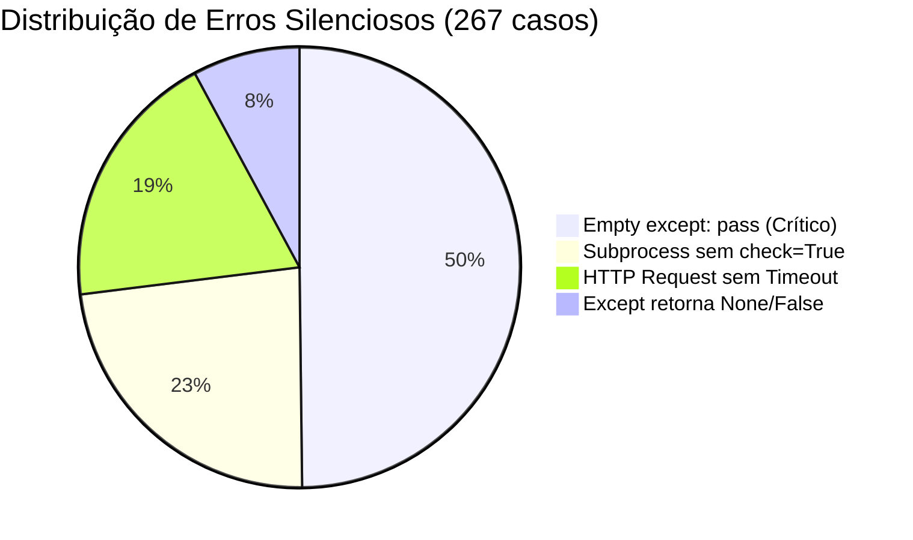
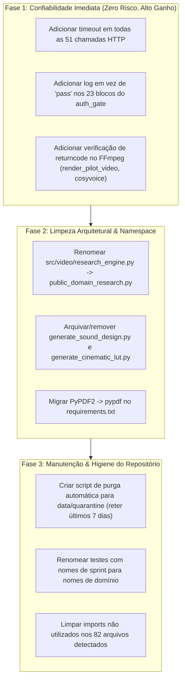

# Relatório de Auditoria Técnica Profunda — DarkFactory

> **Data da Auditoria:** 16 de Novembro de 2026  
> **Escopo Auditado:** 113 arquivos Python, 308 testes unitários, infraestrutura de scripts, dados locais e dependências.  
> **Status da Suíte de Testes:** 308 passed, 2 skipped, 1 warning (100% de passagem nos testes existentes).

---

## Executive Summary (Visão Geral)

| Categoria Auditada | Quantidade Detectada | Nível de Risco | Impacto Operacional |
| :--- | :---: | :---: | :--- |
| **Erros Silenciosos (Empty `except: pass`)** | **133** ocorrências | 🔴 Crítico | Mascara falhas de automação web, IO e parsing |
| **Comandos CLI sem Verificação (`subprocess.run`)** | **62** chamadas | 🟡 Alto | FFmpeg falha sem alertar; gera mídias vazias |
| **Requisições HTTP sem Timeout** | **51** chamadas | 🟡 Alto | Risco de travamento (*hanging*) infinito do processo |
| **Módulos Não Utilizados / Órfãos em Produção** | **8** módulos | 🟡 Médio | Código morto, distração arquitetural e confusão de manutenção |
| **Módulos com Nomes Duplicados / Sobrepostos** | **4** pares | 🟡 Médio | Ambiguidade de imports (`research_engine`, `youtube_booster`) |
| **Arquivos com Imports Não Usados** | **82** arquivos | 🟢 Baixo | Poluição de namespace e acoplamento desnecessário |
| **Acúmulo de Dados Locais / Bloat de Disco** | **~1.4 GB** | 🟢 Baixo | 566MB em `chrome_session` + 42 diretórios em `quarantine/` |
| **Dependência Depreciada** | `PyPDF2` (1) | 🟢 Baixo | Warning de depreciação persistente no pytest |

---

## 1. O Que Existe e NÃO Está Sendo Usado (Dead Code & Módulos Órfãos)

A esteira evoluiu rapidamente ao longo de múltiplos sprints. Isso gerou módulos que ficaram obsoletos ou foram criados apenas para testes conceituais, sem integração na esteira oficial (`run_pilot_pipeline.py`, dashboard ou daemons).

### 1.1 Módulos 100% Desconectados (Sem Uso em Produção e Sem Testes)
Estes arquivos existem no repositório, mas não são chamados por nenhum outro arquivo nem pela suíte de testes:

1. **`src/generate_cinematic_lut.py`** (91 linhas)
   - **O que faz:** Gera matematicamente um arquivo 3D LUT `.cube` Kodak 2383.
   - **Diagnóstico:** O arquivo gerado (`data/luts/cold_war_documentary.cube`) já existe fisicamente no disco. O script de geração nunca foi integrado ao pipeline nem possui testes. Pode ser movido para `scripts/tools/` ou arquivado.
2. **`src/generate_sound_design.py`** (287 linhas)
   - **O que faz:** Gera sound design procedural com durações e timestamps fixos hardcoded (`total_duration = 39.65`, `t_scene1_end = 16.85`).
   - **Diagnóstico:** Ficou completamente obsoleto com a introdução do `src/audio_mixer_master.py` e da biblioteca modular `src/video/foley_library.py`. Não é chamado em lugar nenhum e pode ser excluído com segurança.

### 1.2 Módulos "Test-Only" (Fantasmas de Arquitetura)
Estes módulos possuem testes unitários dedicados em `tests/`, mas **nenhum módulo de produção** (`run_pilot_pipeline.py`, dashboard, daemon ou scripts de montagem) os utiliza:

| Arquivo | Linhas | Teste que o referencia | Motivo do Desuso / Observação |
| :--- | :---: | :--- | :--- |
| **`src/video/cinematography_dop.py`** | 443 | `test_master_knowledge.py` | Concebido para validar regras de enquadramento; a esteira passou a delegar prompts diretamente ao `nolan_director.py`. |
| **`src/video/color_psychology.py`** | 365 | `test_master_knowledge.py` | Regras estéticas de cores não integradas aos motores generativos de vídeo. |
| **`src/video/knowledge_distiller.py`** | 312 | `test_master_knowledge.py` | Extrator de PDFs históricos; único usuário de `PyPDF2`. A pesquisa real foi centralizada na Wikipedia e arquivos desclassificados via web. |
| **`src/video/shot_cards.py`** | 288 | `test_master_knowledge.py` | Gerador de cartões de tomada que foi substituído pelos prompts Dual-Shot nativos do Nolan. |
| **`src/runninghub_foley_bot.py`** | 340 | `test_voice_and_audio_engines.py` | Bot de scraping para Foley no RunningHub. O projeto migrou para Foley CC0 procedural e local (`foley_library.py`), tornando a automação web de foley dispensável. |
| **`src/ai_engine_suite.py`** | 224 | `test_ai_engine_suite.py` | Suíte abstrata de LLM/Vision. A produção usa diretamente `src/google_flow_bot.py` e `src/factory/runninghub_bot.py`. |

### 1.3 Dados Locais Órfãos e Falta de Política de Purga
- **`data/quarantine/` (42 diretórios de falhas)**: Cada falha de geração do MiniMax H3 ou Music Flow cria um diretório com logs de erro (`data/quarantine/vid_*`, `minimax_music_fail_*`). Não há script de expiração (TTL) ou limpeza periódica.
- **`chrome_session/` (565.75 MB)**: Diretório com centenas de arquivos de cache de perfil Chromium/Playwright. Está corretamente incluído no `.gitignore`, mas consome espaço local em disco e armazena cookies que expiram com frequência.
- **`data/audio/` (547.76 MB)** e **`data/output/` (239.77 MB)**: Quase 800 MB de arquivos de mídia temporários já renderizados do piloto antigo (`the_1983_soviet_glitch`).

---

## 2. Dívidas Técnicas & Inconsistências Arquiteturais

### 2.1 Módulos com Nomes Idênticos e Conflito de Namespace
Existem arquivos com o **mesmo nome exato** em diretórios diferentes, causando confusão mental e dependência frágil de caminhos de import:

1. **`src/research_engine.py` vs `src/video/research_engine.py`**:
   - `src/research_engine.py` (417 linhas): Implementa `WikipediaResearcher` e busca de fatos na Wikipedia.
   - `src/video/research_engine.py` (322 linhas): Implementa `PublicDomainResearchEngine` e verificação de licenças de domínio público.
   - *Problema:* No `src/research_engine.py` existe o import `from src.video.research_engine import PublicDomainResearchEngine`. Um desenvolvedor ou agente pode facilmente importar o módulo errado.
   - *Solução Recomendada:* Renomear `src/video/research_engine.py` para `src/video/public_domain_research.py`.
2. **`src/youtube_algorithm_booster.py` vs `src/video/youtube_booster.py`**:
   - `src/youtube_algorithm_booster.py` (1059 linhas): Motor de geração de metadados multilíngues, tags e capítulos usado pelo `run_pilot_pipeline.py`.
   - `src/video/youtube_booster.py` (790 linhas): Bridge de metadados consumida pelas rotas do dashboard (`dashboard_routes.py`).
   - *Problema:* Lógica de otimização de YouTube duplicada e dividida entre dois arquivos de ~1000 e ~800 linhas.
3. **`src/audio_mixer_master.py` vs `src/video/audio_engine.py`**:
   - Ambos contêm rotinas de ducking, cálculo de loudness EBU R128 e invocação do FFmpeg. O pipeline utiliza `audio_mixer_master.py`, enquanto o `src/video/audio_engine.py` possui funções auxiliares consumidas pelo dashboard.

### 2.2 Dependências Depreciadas
- **`PyPDF2>=3.0.0` no `requirements.txt`**:
  O pacote foi descontinuado oficialmente em favor do `pypdf`. Toda execução de testes emite:
  ```text
  DeprecationWarning: PyPDF2 is deprecated. Please move to the pypdf library instead.
  ```
  Como `PyPDF2` só é referenciado em `src/video/knowledge_distiller.py` (que é *test-only*), a dependência pode ser atualizada para `pypdf` ou removida se o módulo for aposentado.

### 2.3 Nomenclatura Histórica da Suíte de Testes
Os testes abaixo foram nomeados com base em sprints passadas, dificultando a rastreabilidade por capacidade do sistema:
- `tests/test_sprint7_documentary_sync.py` → deve ser `test_documentary_sync.py`
- `tests/test_sprint8_foley_and_reverse.py` → deve ser `test_foley_and_reverse_engineering.py`
- `tests/test_sprint9_storyboard_and_monetization.py` → deve ser `test_storyboard_and_monetization.py`
- `tests/test_sprint10_shorts_and_captions.py` → deve ser `test_shorts_and_captions.py`

---

## 3. Erros Silenciosos & Falhas Mascaradas (Silent Failures)

A auditoria identificou **267 padrões de risco de erro silencioso** no código fonte:



### 3.1 Os Piores Vilões de `except: pass` (133 ocorrências)
Tratamento vazio de exceção esconde bugs reais, corrupção de arquivos e falhas de infraestrutura:

1. **`src/factory/runninghub_bot.py` (39 blocos `except Exception: pass`)**:
   - O bot do Playwright engole exceções em cliques de botão, preenchimento de inputs e seletores de download.
   - *Cenário de Falha Silenciosa:* Se o RunningHub mudar a interface ou um modal sobrepor o botão de export, o bot silencia o erro, segue o fluxo e falha apenas muito depois, sem mensagem clara do que ocorreu.
2. **`src/auth_gate.py` (23 blocos `except Exception: pass`)**:
   - Leitura de cookies, parsing de sessões JSON e verificação de storage states contêm blocos que descartam falhas.
   - *Cenário de Falha Silenciosa:* Um arquivo de sessão corrompido ou token expirado é ignorado silenciosamente, gerando falha não explicada no meio da produção dos vídeos.
3. **`src/music_flow_bot.py` (7 blocos) e `src/runninghub_foley_bot.py` (3 blocos)**:
   - Captura e decodificação de áudio descartam `EOFError` e `Exception` gerais.
4. **`src/dashboard/readers.py` (4 blocos)**:
   - Linhas 78, 96, 128, 417: engolem `Exception` durante leitura de manifests e JSONs de telemetria.

### 3.2 Execução de Subprocessos sem Verificação (62 chamadas)
Diversos scripts invocam comandos externos (especialmente FFmpeg) sem `check=True` e sem inspecionar `returncode`:

- **`src/cosyvoice_master.py` (Linha 293)**:
  ```python
  subprocess.run(concat_cmd, stdout=subprocess.DEVNULL, stderr=subprocess.DEVNULL)
  ```
  Se a concatenação dos stems de voz falhar por falta de disco ou lista inválida, o script não gera exceção e a próxima etapa tenta ler um arquivo inexistente.
- **`src/render_pilot_video.py` (Linhas 456 e 488)**:
  Concatena takes de vídeo com `stdout=DEVNULL, stderr=DEVNULL` sem verificar status.
- **`src/generate_pilot_audio.py` (Linhas 67, 154)**:
  Conversão de áudio sem validação do código de saída.

### 3.3 Requisições HTTP sem Timeout (51 chamadas)
Chamadas de rede a APIs externas sem parâmetro `timeout` deixam a esteira vulnerável a travamentos perpétuos (*hangs*):
- **`src/video/minimax_h3_engine.py` (Linhas 189, 317, 347)**: Consultas de status de render na API do MiniMax sem timeout configurado.
- **`src/video/minimax_music_engine.py` (Linhas 167, 269)**: Polling de geração musical sem timeout.
- **`src/video/voice_engine.py` (Linha 231)**: Síntese TTS via HTTP sem timeout.

---

## 4. Plano de Ação Recomendado (Matriz de Prioridade)



### Resumo das Ações Sugeridas:
1. **Curto Prazo (Bugs & Estabilidade)**:
   - Substituir `except Exception: pass` por `logger.warning(f"...", exc_info=True)` nos componentes críticos (`auth_gate.py`, `runninghub_bot.py`).
   - Fixar `timeout=60.0` em todas as chamadas `requests.get/post` dos motores MiniMax e TTS.
   - Garantir `check=True` ou verificação explícita de `res.returncode == 0` nas chamadas ao FFmpeg.
2. **Médio Prazo (Desacoplamento)**:
   - Desambiguar os módulos duplicados (`src/research_engine.py` e `src/video/research_engine.py`).
   - Consolidar a lógica de YouTube entre `src/youtube_algorithm_booster.py` e `src/video/youtube_booster.py`.
   - Limpar arquivos órfãos sem impacto no pipeline de produção.
3. **Longo Prazo (Higiene)**:
   - Atualizar `requirements.txt` eliminando o warning do `PyPDF2`.
   - Adicionar comando CLI no `run_pilot_pipeline.py` para limpeza de cache e quarentena (`--clean-cache`).
